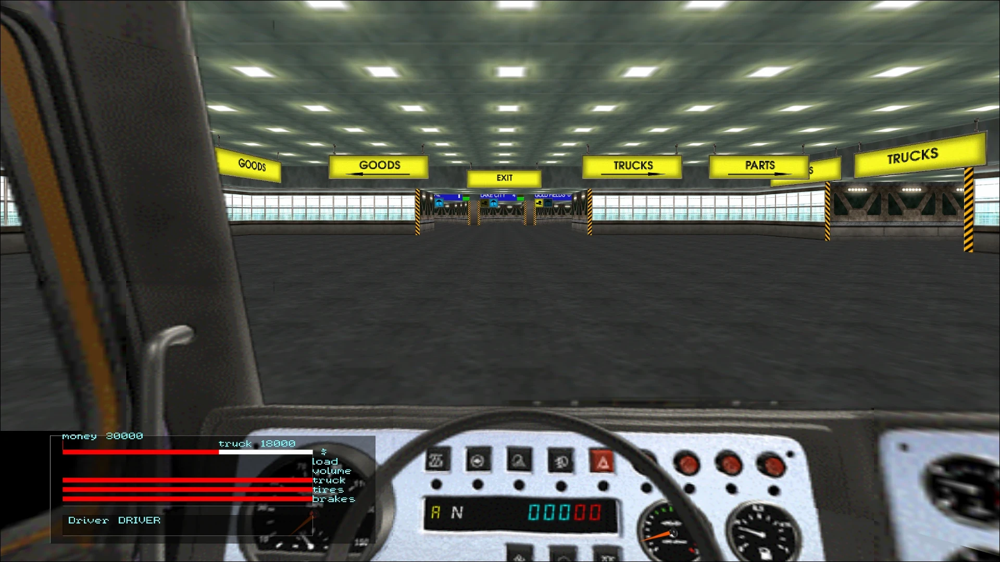

# Hard Truck SkoFix

A fix for modern systems.

For Hard Truck: Road to Victory.

## Features

**System**
- Crash fix when a drive starts (clock precision with long system uptime)
- Crash fix in portal rendering
- Accelerator mode on graphics cards with 2 GB of memory or more
- Plays without the disc
- Disc found in any drive
- Runs from a folder copied from the disc, without the original installer

**Performance**
- 60 FPS limit (configurable)
- No double frame pacing in accelerator mode

**Graphics** (accelerator mode)
- 16:9 widescreen with correct proportions (other aspect ratios untested)
- Resolution of the screen or higher, whole multiples of the original where possible
- Full screen without changing the display mode
- Anti-aliasing and anisotropic filtering

The graphics features use [dgVoodoo2](https://github.com/dege-diosg/dgVoodoo2) by Dege, which is included in the release.

All features can be configured in `HardTruck.SkoFix.ini`, dgVoodoo2 in `dgVoodoo.conf`.

## Installation

1. Copy all files from the disc into a new folder, outside of `Program Files`. Alternatively use the original installer: Maximum, without DirectX.
2. Download the latest [release](https://github.com/skoinks/HardTruck.SkoFix/releases).
3. Extract the archive into the game folder, next to `HTruck.exe`.
4. Start `HTruck.exe`.
5. Select Accelerator under Options.

To uninstall, delete `dinput.dll`, `DDraw.dll`, `D3DImm.dll`, `dgVoodoo.*` and `HardTruck.SkoFix.*`.

## Limitations

- Not tested with the original installer.
- In widescreen, 2D panels are stretched and the cab has a gap at the bottom left.

## Compatibility

| Version | Status |
|---|---|
| English, 6 April 1999 | Supported |
| Other versions | Not supported, left unchanged |

Tested on Windows 10. `HTruck.exe` SHA-1: `4ff72b4e67d56d2d68f2244b26d5bdbda388c517`

## Reporting issues

Open an [issue](https://github.com/skoinks/HardTruck.SkoFix/issues) and attach `HardTruck.SkoFix.log`.

## Building

Requires Visual Studio 2022 with the C++ tools.

| Script | Purpose |
|---|---|
| `build.bat` | Builds `build/dinput.dll` |
| `tools/get-dgvoodoo.bat` | Downloads and verifies dgVoodoo2 |
| `release.bat` | Packs `dist/HardTruck.SkoFix.zip` |

## License

[MIT](LICENSE). dgVoodoo2 is not covered by this license, see its [readme](http://dege.fw.hu/dgVoodoo2/ReadmeGeneral/).

Not affiliated with SoftLab-NSK. Hard Truck is a trademark of its respective owner.
